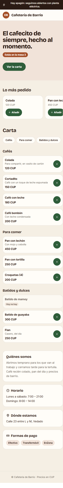
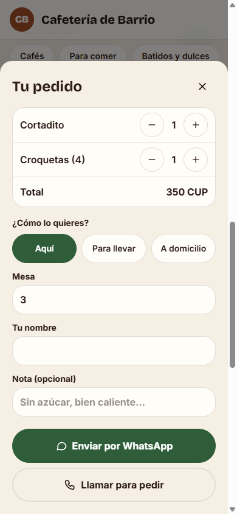
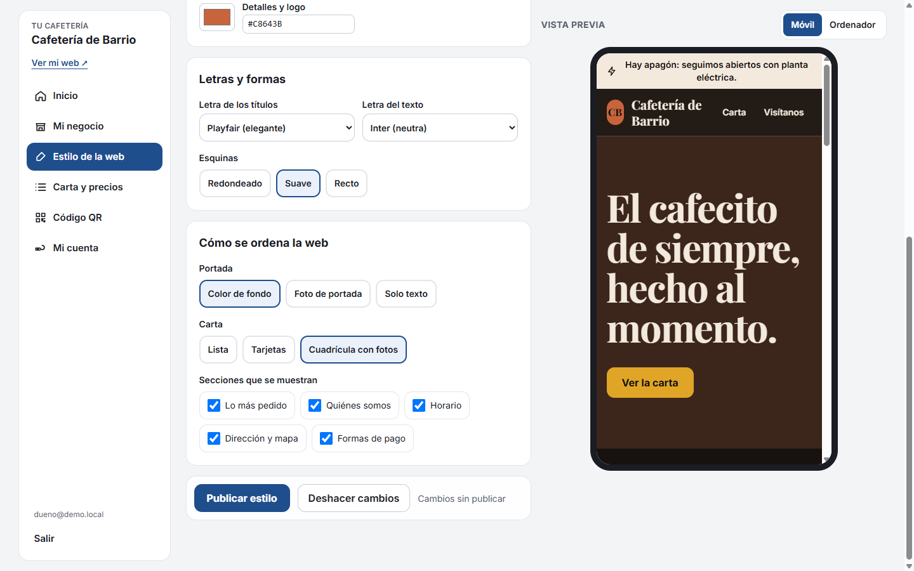

# Cafe Kit

A website template for small cafés that each owner customises from their own panel: the menu, prices, what is sold out today, opening hours, how customers order, and the whole look of the site. Customers reach it by scanning a QR code on the table or the counter.

Built for cafés in Cuba (prices in CUP, payments by Transfermóvil and EnZona, a "power cut" notice), but nothing is tied to one business: one install serves many cafés, each with its own address, owner account and style.

> **Español:** plantilla de web para cafeterías con carta QR, pedidos por WhatsApp/Telegram/llamada y un panel con login donde cada dueño cambia la carta, los precios, el estilo y el orden de su web sin saber programar.

<p>
  
  
  
</p>

## What it does

**For the customer** (`/c/<café>`)
- Scans the QR and lands on the menu; a per-table QR fills in the table number.
- Adds items, chooses *here / takeaway / delivery*, and sends the order as a ready-written message by **WhatsApp**, **Telegram** (copied and the chat opened, since Telegram can't prefill) or a **phone call**.
- Sold-out items are labelled "Hoy no hay" and can't be added.

**For the café owner** (`/panel`, login required)
- **Menu and prices:** sections and products, inline price editing that saves on blur, a sold-out switch, photos, featured items, reordering.
- **Style:** four starting presets (Clásico, Colonial, Moderno, Nocturno), then any colour for background, cards, text, buttons and details; six fonts for headings and body; corner style; list / cards / photo-grid menu; colour, photo or text-only hero; show or hide each section. The preview beside the controls *is* the real storefront component, and text colour on buttons is chosen automatically for contrast. The panel warns when a colour pair falls under WCAG AA.
- **Business:** name, tagline, about, address and map link, hours, ordering channels, accepted payments, currency, logo, cover photo, and a one-line notice ("hay apagón…").
- **QR:** download PNG or SVG, a printable poster in the café's style, and a sheet of cut-out cards for N tables. Visits are counted by source, so the dashboard shows QR vs link and which tables scan most.
- **Publish switch:** a new site stays private (404 to the public) until the owner turns it on.

**For whoever sells the service** (platform admin)
- Creates cafés with their owner account and starting style, and can switch into any café's panel to help.

## Stack

- **Next.js 16** (App Router, Server Actions, React 19) + TypeScript + Tailwind CSS 4
- **SQLite via libSQL**: one file holds everything, images included. `DATABASE_URL` can point at a Turso/libSQL server without code changes.
- **Auth:** bcrypt passwords, random session tokens stored hashed in the database (logout and password change revoke them), httpOnly cookies, a login rate limit.
- Every write re-checks the session and is scoped to the café the user may edit; owners can't reach other cafés or the admin pages.
- Uploads are sniffed by their bytes (JPEG/PNG/WebP only, 2 MB), so an SVG or a renamed file can't carry script. Theme JSON is whitelisted key by key, so a colour can't inject CSS.
- `qrcode` for the codes; `zod` for input validation.

## Run it

```bash
npm install
npm run dev          # http://localhost:3000
```

The first start creates `data/cafe-kit.db` with two demo cafés. Demo accounts (password `demo1234`):

| Email | Role |
| --- | --- |
| `dueno@demo.local` | owner of *Cafetería de Barrio* |
| `colonial@demo.local` | owner of *Rincón Colonial* |
| `admin@demo.local` | platform admin (all cafés) |

Demo prices are illustrative.

## Tests

```bash
npm test             # unit: theme parsing, contrast maths, order message, links (Vitest)
npm run build && npm run e2e   # end-to-end on a fresh database (Playwright)
```

The end-to-end suite runs one story: a customer scans a table QR and builds a WhatsApp order; an owner changes a price, marks an item sold out, adds a section and product, restyles the site and prints table QRs, and each change is checked on the public page; an owner is kept out of the admin area; the admin creates a café that stays 404 until its owner publishes it. CI also builds the Docker image and checks the container serves the demo.

## Deploy

`render.yaml` deploys the demo to Render's free plan (New → Blueprint). It reseeds on every start so the public demo stays clean. For a real café, mount a disk at `/app/data` (or set `DATABASE_URL`), set `SEED_DEMO=false` with `ADMIN_EMAIL` and `ADMIN_PASSWORD`, and set `PUBLIC_URL` to the final domain so the QR codes point at it.

| Variable | Purpose |
| --- | --- |
| `DATABASE_URL` | `file:…` path or `libsql://…` URL (default `data/cafe-kit.db`) |
| `DATABASE_AUTH_TOKEN` | token for a remote libSQL database |
| `PUBLIC_URL` | base URL printed in the QR codes |
| `SEED_DEMO` | `false` to start with an empty database |
| `ADMIN_EMAIL`, `ADMIN_PASSWORD` | with `SEED_DEMO=false`, the first platform admin created on an empty database |

## License

MIT
